# THE KINGS TRIBE — Operations Platform
## User Training & Onboarding Guide

*Draft 0.1 · October 2026 · Training environment, fictional data. DRAFT — for review.*

## Contents

2. [How to Use This Guide](#2-how-to-use-this-guide)
3. [Roles & Access Overview](#3-roles-access-overview)
4. [Getting Started](#4-getting-started)
5. [Dashboard & Navigation](#5-dashboard-navigation)
6. [Sunday Reporting](#6-sunday-reporting)
7. [Requisitions](#7-requisitions)
8. [Purchase Orders & Ordering](#8-purchase-orders-ordering)
9. [Receipts, Reconciliation & Closing](#9-receipts-reconciliation-closing)
10. [Reports](#10-reports)
11. [Administration](#11-administration)
12. [External Requester Guide](#12-external-requester-guide)
13. [Notifications & Phone Alerts](#13-notifications-phone-alerts)
14. [Troubleshooting & FAQ](#14-troubleshooting-faq)
15. [Role Quick Reference](#15-role-quick-reference)
16. [Support](#16-support)
17. [Revision History](#17-revision-history)

## 2. How to Use This Guide

This guide walks through the Operations Platform one task at a time. Each task page follows the same pattern:

- **What this does** — the purpose of the screen or action.
- **Who can do it** — the roles that see it.
- **Step-by-step** — numbered actions in the app.
- **What happens next** — the result and any follow-on work.
- **Important notes** — rules, limits and tips.

All screens in this guide were captured from a **separate training environment** that contains only fictional people, requests and amounts. Training screens show a gold **TRAINING ENVIRONMENT · FICTIONAL DATA** banner and the app name **TKT Training**; the live (production) system does not show the training banner.

Request numbers shown in this guide (for example TKT-REQ-2026-0043) are fictional training examples.

> **NOTE:** Figure labels tell you what each image is: **Screenshot** (captured from the app), **Real capture** (captured on a phone), **Training illustration** (a drawn guide to a phone or iOS screen — not a screenshot), or **Rendered email** (produced from the real email template and never sent).

> **TIP:** Not sure what you can see? Start with Section 3, Roles & Access Overview, then Section 15, Role Quick Reference.

### Conventions

- **Bold** text matches a button, menu or field in the app.
- “Requisition” and “request” mean the same thing.
- Times and dates follow the church’s configured timezone.

## 3. Roles & Access Overview

Every staff member signs in with their own account and one or more roles. The menu shows only what your roles allow; pages you cannot use are not shown, and opening one directly shows a “not allowed” page.

| Role | Access |
| --- | --- |
| Administrator | Full access: everything in this guide, including Administration (setup, settings, users, roles, links, departments, categories, request types, audit log). |
| Head of Finance | Dashboard · Sunday finance · Requisitions and review · Purchase Orders · vendor orders · Receipts and reconciliation · Disbursements · Reports · Categories · Requisition links · Audit log. No user, role, settings, setup, department or request-type administration. |
| Finance User | Dashboard · Sunday finance entry and view. |
| Reporting User | Dashboard · Sunday attendance entry and view · Reports (Attendance). |
| Viewer | Dashboard (attendance) only. |
| External requester | No account. Submits requests through a secure requisition link only. |

> **IMPORTANT:** Department and ministry leads do not get accounts. They send requests through a secure **requisition link** that can only submit requests — they never see finances, other requests or anything internal.

Administrators assign roles in **Administration → Users**. Role names are fixed in the app and are used throughout this guide.

## 4. Getting Started

### Sign in

**What this does:** Opens your account. Your roles decide what you see after signing in.

**Who can do it:** All staff with an account.

**Step-by-step**

1. Open the Operations Platform address provided by your administrator.
2. Enter your **Email address** and **Password**.
3. Tap **Sign in**.

**What happens next:** Your Dashboard opens. If you opened a direct link before signing in, you are taken there instead.

**Important notes**

- Accounts are created by invitation only — there is no self sign-up.
- On a phone, install the app first if you want phone alerts (later in this section).

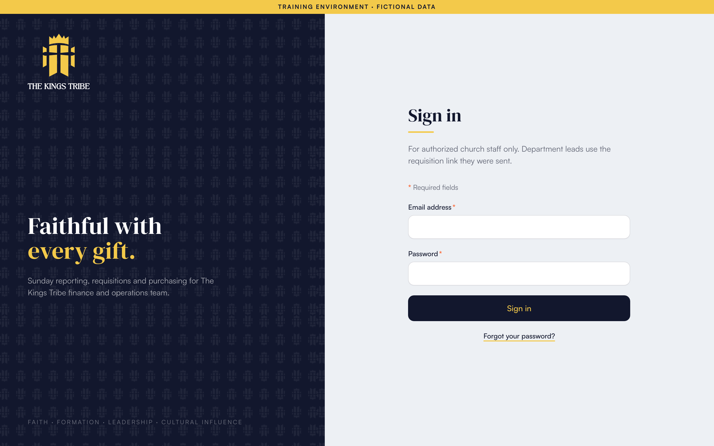
*Screenshot — S01 · Sign in (desktop)*

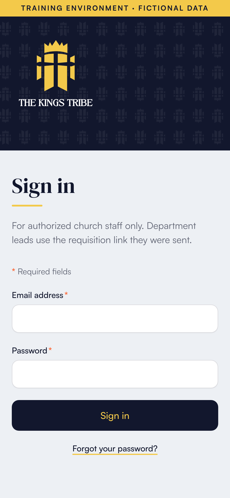
*Screenshot — S01 · Sign in (phone)*

### Forgot password

**What this does:** Requests a password reset for your account.

**Who can do it:** All staff with an account.

**Step-by-step**

1. On the sign-in page, tap **Forgot your password?**
2. Enter your account **Email address**.
3. Tap **Send reset link** to submit the reset request.
4. Follow the instructions provided by the sign-in service to choose a new password.

**What happens next:** The page says it will send you a secure link to choose a new password. Once you have set it, sign in. **Back to sign in** returns to the sign-in page.

**Important notes**

- Delivery of the reset message depends on the configured authentication email service.
- In the training environment this form is shown but not submitted.

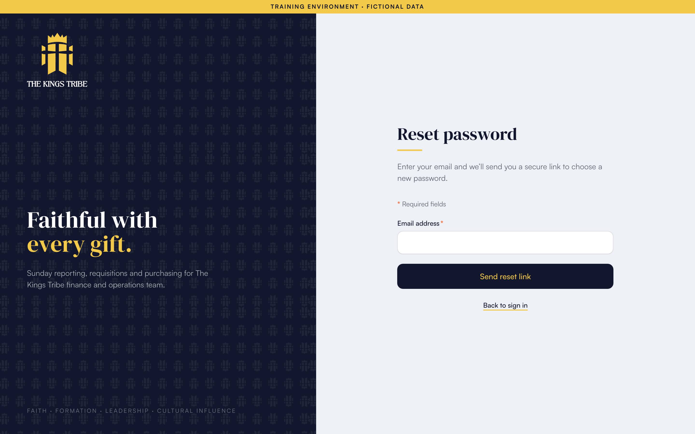
*Screenshot — S02 · Reset password*

### Install the app on iPhone

**What this does:** Adds the Operations Platform to your Home Screen so it opens like an app. Required for phone alerts on iPhone.

**Who can do it:** Any staff member using an iPhone (iOS 16.4 or later).

**Step-by-step**

1. Open the platform address in **Safari**.
2. Tap **Share**.
3. Choose **Add to Home Screen**, then **Add**.
4. Open the app from the Home Screen and sign in there.

**What happens next:** The app opens full-screen. Continue to “Enable phone notifications”.

**Important notes**

- The installed app does not share Safari’s sign-in — sign in again inside it.
- Share-menu wording and position may vary by iOS version. Full illustrated steps: Section 13.

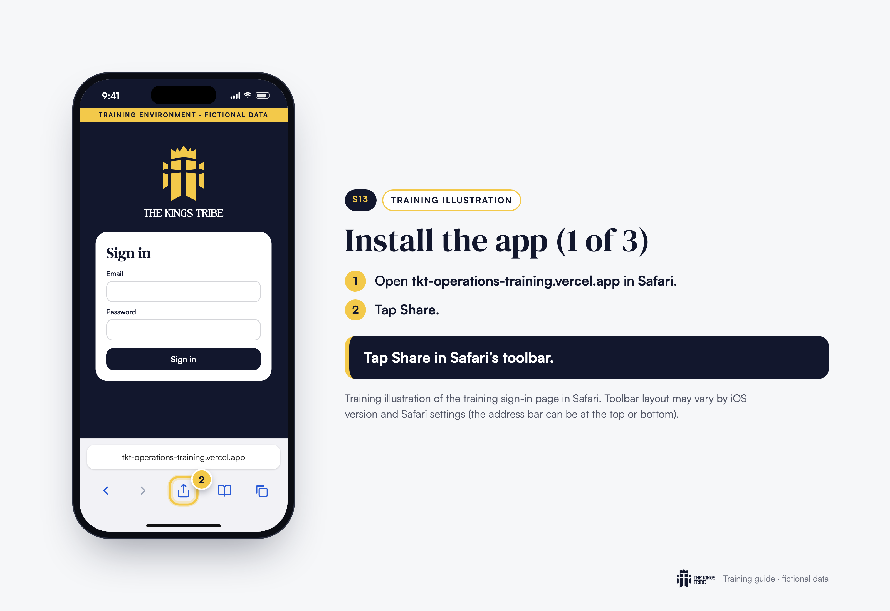
*Training illustration — S13 · Tap Share in Safari*

### Enable phone notifications

**What this does:** Lets this device show short alerts when something needs your attention.

**Who can do it:** Any staff member, on each device they use.

**Step-by-step**

1. Open **Notifications** (bell → **View all notifications**).
2. In the **Phone notifications** card, tap **Enable phone notifications**.
3. When the device asks, tap **Allow**.

**What happens next:** The card shows **On for this device.** and lists your devices.

**Important notes**

- On iPhone this works only in the app added to the Home Screen.
- Alerts show only a short message; details open in the app after you sign in.
- Full illustrated steps and alert levels: Section 13.

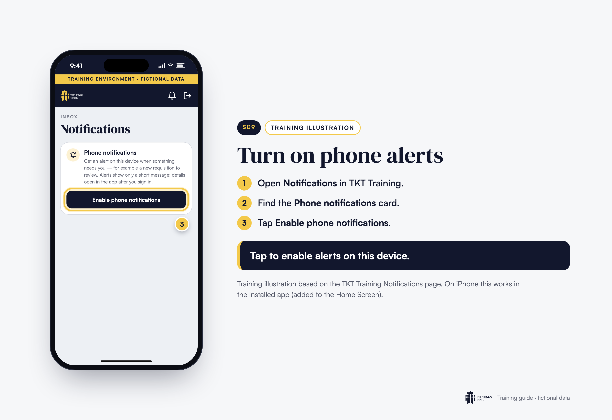
*Training illustration — S09 · The Phone notifications card*

## 5. Dashboard & Navigation

### Dashboard

**What this does:** Your starting page: work that needs attention, this Sunday’s entry and the latest attendance and giving figures.

**Who can do it:** All staff. Each role sees only its own cards and figures.

**Step-by-step**

1. Sign in — the Dashboard opens.
2. Use **Needs attention** cards to jump to waiting work.
3. Use **Enter this Sunday** to record the current service.
4. Change the period (4 weeks, 12 weeks, this month, quarter, year to date or custom) to update figures and charts.

**What happens next:** Tap any card to open the matching filtered list.

**Important notes**

- A Viewer sees attendance figures only (second image).

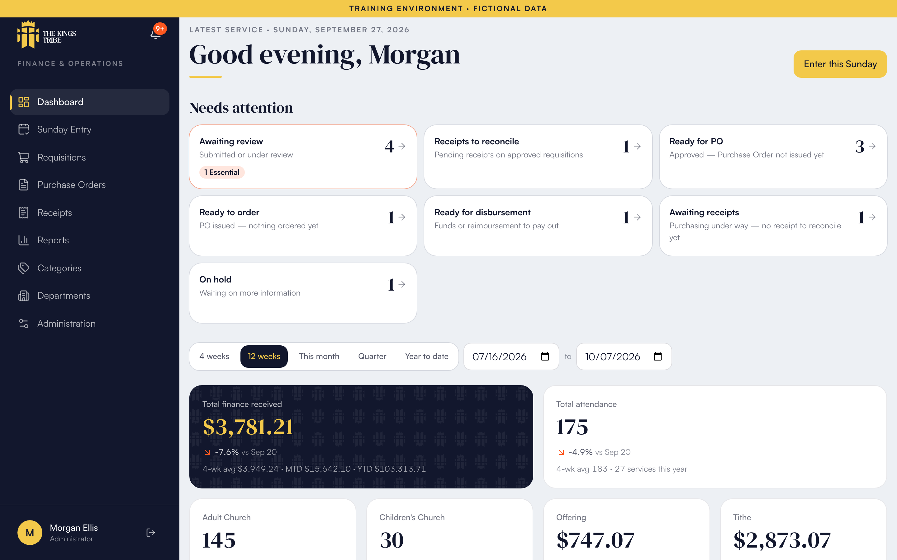
*Screenshot — S03 · Dashboard — Administrator*

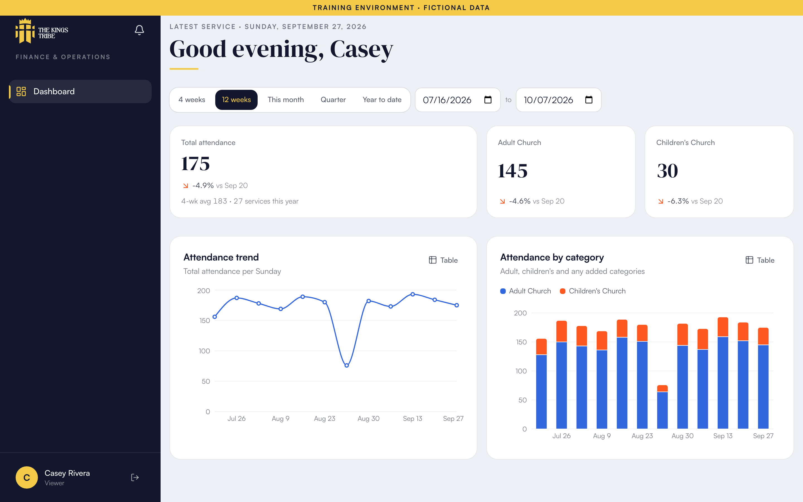
*Screenshot — S04 · Dashboard — Viewer*

### Phone navigation

**What this does:** On a phone, the main sections sit in a bottom bar.

**Who can do it:** All staff.

**Step-by-step**

1. Use the bottom bar for **Dashboard**, **Sunday** and **Requisitions**.
2. Tap **More** for the other sections your role allows.
3. Use the top bar for the bell and sign out.

**What happens next:** The More menu lists only the sections you can use and shows who is signed in.

**Important notes**

- Menus differ by role — if a section is missing, your role does not include it.

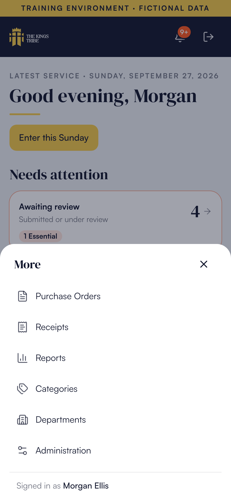
*Screenshot — S05 · Bottom bar and More menu*

### Notifications

**What this does:** In-app notifications tell you when work arrives or changes.

**Who can do it:** All staff.

**Step-by-step**

1. Tap the **bell** to see recent notifications; the badge shows how many are unread.
2. Tap a notification to open it — it is marked read.
3. Tap **Mark all as read** or **View all notifications**.
4. On the Notifications page, filter by **All**, **Unread**, **Requisitions**, **Purchasing**, **Finance** or **System**.

**What happens next:** Each notification opens the exact page it refers to.

**Important notes**

- Important items are labelled **Important**.
- Notifications are always available here, even if phone alerts are off.

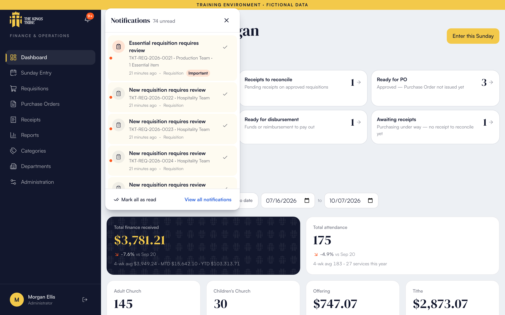
*Screenshot — S06 · Bell panel*

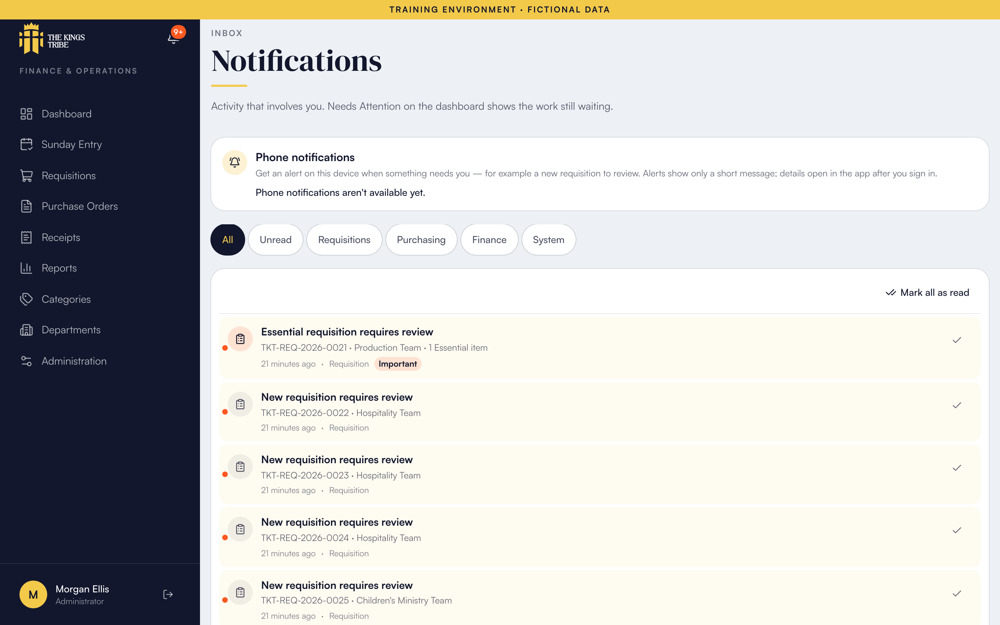
*Screenshot — S07 · Notifications page*

### Notifications on a phone

**What this does:** The same Notifications page, sized for a phone.

**Who can do it:** All staff.

**Step-by-step**

1. Tap **More**, or tap the bell and choose **View all notifications**.
2. Scroll the filter chips sideways to change the view.

**What happens next:** Tap any notification to open its page.

**Important notes**

- Phone alerts (Section 13) are set up from this page.

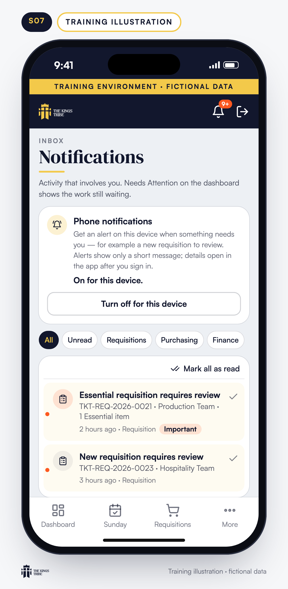
*Training illustration — S07 · Notifications on a phone*

### Needs Attention

**What this does:** Counts of work waiting for your action, each opening a filtered list.

**Who can do it:** Roles that act on requisitions (Administrator, Head of Finance).

**Step-by-step**

1. On the Dashboard, find **Needs attention**.
2. Tap a card — for example **Awaiting review**.
3. Work through the filtered list; open a requisition to act on it.

**What happens next:** Counts update as work moves on. Cards include Awaiting review, Receipts to reconcile, Ready for PO, Ready to order, Ready for disbursement, Awaiting receipts and On hold.

**Important notes**

- Awaiting review highlights Essential items and requests assigned to you.

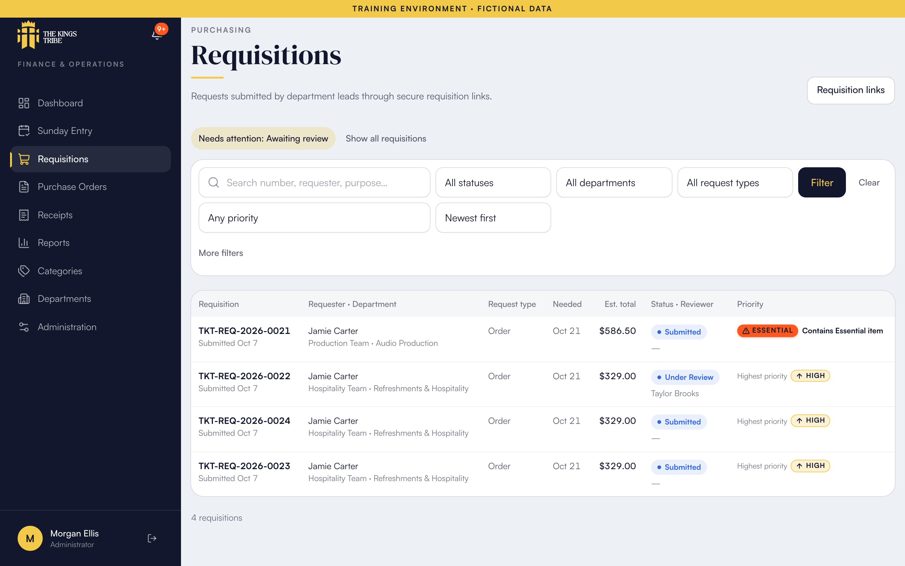
*Screenshot — S08 · Awaiting review — filtered list*

## 6. Sunday Reporting

### Sunday entry

**What this does:** Records attendance and finance received for a service.

**Who can do it:** Attendance: Administrator, Reporting User. Finance: Administrator, Head of Finance, Finance User.

**Step-by-step**

1. Open **Sunday Entry** (or **Enter this Sunday** on the Dashboard).
2. Check the **Service date** and **Service**.
3. Enter attendance by category and/or finance by category.
4. Tap **Save Sunday entry**.

**What happens next:** The service appears under **Recent services** and in Dashboard and Reports figures.

**Important notes**

- You see only the sections your role allows.
- Totals are recalculated by the server when you save.
- The badge shows **New entry** or **Editing saved entry**.

*Screenshot — S16 · New Sunday entry*

### Finance entry and notes

**What this does:** Records amounts received per finance category, with an optional note per line.

**Who can do it:** Administrator, Head of Finance, Finance User.

**Step-by-step**

1. Enter each amount in the church’s currency; leave blank if nothing was received.
2. Tap the note icon beside a category to **Add a note**.
3. Check **Total finance received**.
4. Tap **Save Sunday entry**.

**What happens next:** Totals and figures update for that service.

**Important notes**

- Attendance works the same way: enter a headcount per category and check **Total attendance** (Administrator, Reporting User).

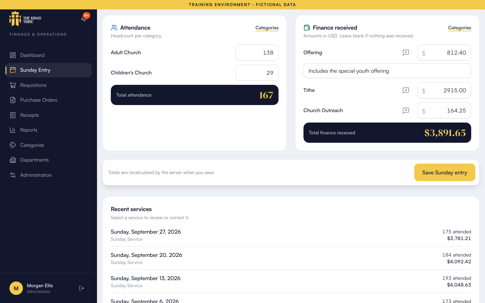
*Screenshot — S17 · Attendance and finance with a note*

### Editing previous services

**What this does:** Corrects a service that was already saved.

**Who can do it:** Same roles as Sunday entry.

**Step-by-step**

1. On **Sunday Entry**, scroll to **Recent services**.
2. Select the service to review or correct.
3. Change the values and tap **Save Sunday entry**.

**What happens next:** The saved entry is updated; Dashboard and Reports reflect the change.

**Important notes**

- The badge reads **Editing saved entry** while you change an existing service.

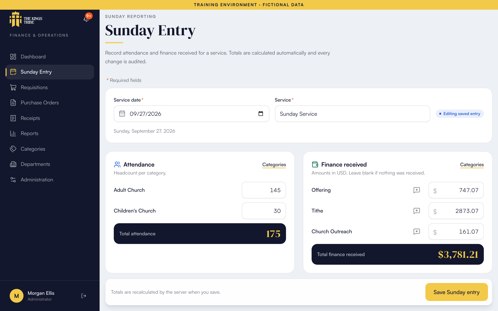
*Screenshot — S18 · Editing a saved service*

## 7. Requisitions

### Requisition list

**What this does:** All requests in one place, newest first, with filters.

**Who can do it:** Administrator, Head of Finance.

**Step-by-step**

1. Open **Requisitions**.
2. Filter by status, department, request type or priority; sort by **Priority (Essential first)** if needed.
3. Tap a requisition number to open it.

**What happens next:** The detail page opens with everything about the request.

**Important notes**

- Each row shows the requester, department, request type, needed date, estimated total, status, reviewer and highest priority.
- Submitted dates follow the church’s timezone.

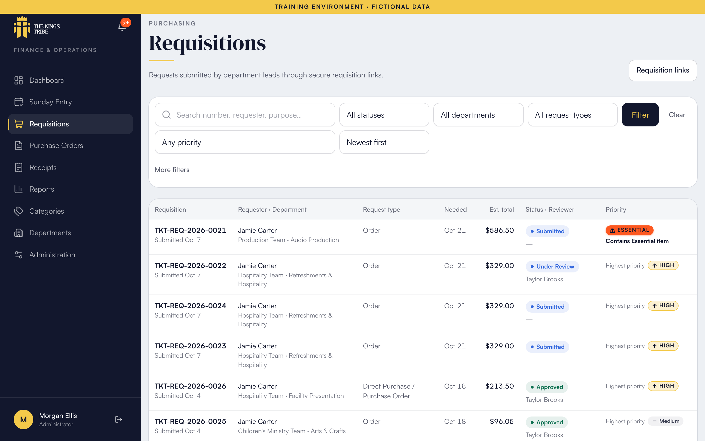
*Screenshot — S19 · Requisition list*

### Requisitions on a phone

**What this does:** The list as cards for small screens.

**Who can do it:** Administrator, Head of Finance.

**Step-by-step**

1. Tap **Requisitions** in the bottom bar.
2. Use the filters at the top, then tap a card.

**What happens next:** The same detail page opens.

**Important notes**

- Cards show the essentials; open one for full details.

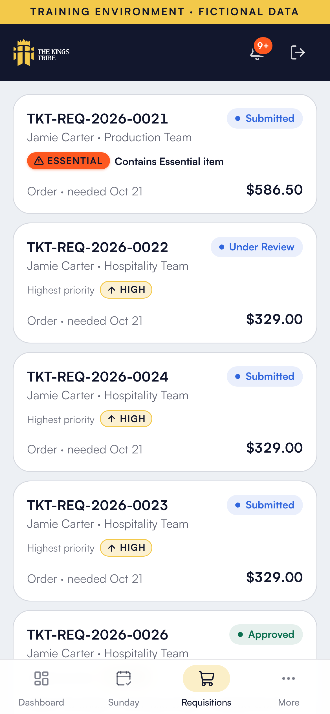
*Screenshot — S19 · Requisition cards*

### Requisition detail

**What this does:** Shows the request, its progress and the actions available now.

**Who can do it:** Administrator, Head of Finance.

**Step-by-step**

1. Open a requisition from the list.
2. Read the status badge, submitted date and needed date.
3. Follow the progress bar. A typical Order path is Submitted → Under Review → Approved → PO Issued → Ordered → Receipt Received → Purchased → Closed.
4. Use the action buttons at the top.

**What happens next:** Actions appear only when they apply to the current status.

**Important notes**

- Statuses and steps vary by decision and request type; for example, a request may be On Hold, Partially Approved or Rejected, and Advance Check includes Check Issued.

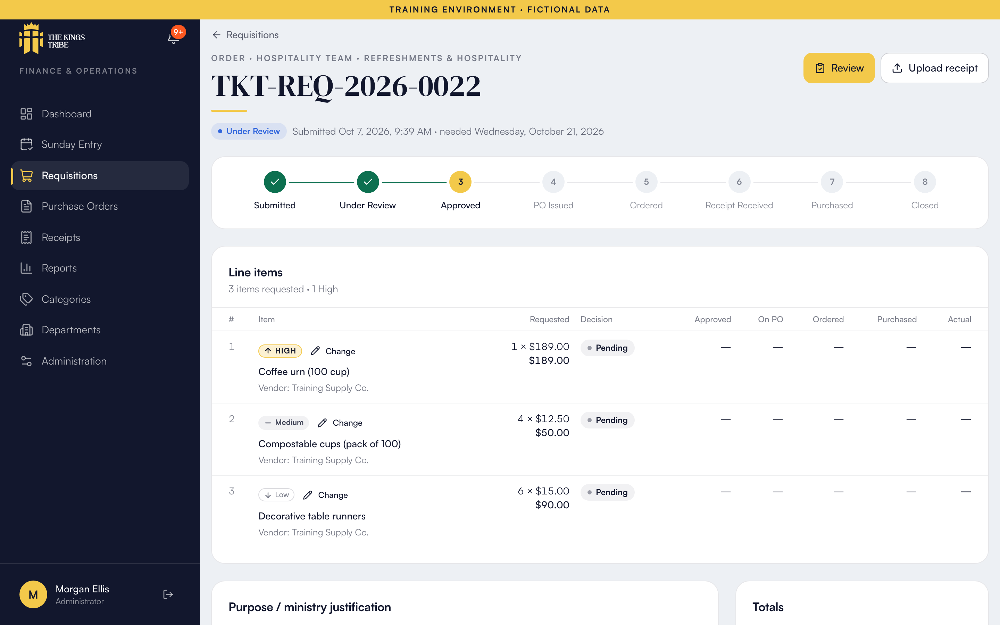
*Screenshot — S20 · Detail header and progress*

### Priorities and Essential items

**What this does:** Each line has a priority: **Essential**, **High**, **Medium** or **Low**. Essential lines include the requester’s reason.

**Who can do it:** Administrator, Head of Finance.

**Step-by-step**

1. Open a requisition and scroll to **Line items**.
2. Read the priority badge on each line.
3. For Essential lines, read **Why essential**.

**What happens next:** Use priority to decide what to review first.

**Important notes**

- Priority is information only — you can still approve, hold or reject any item.
- Requests with Essential items are highlighted in lists and alerts.

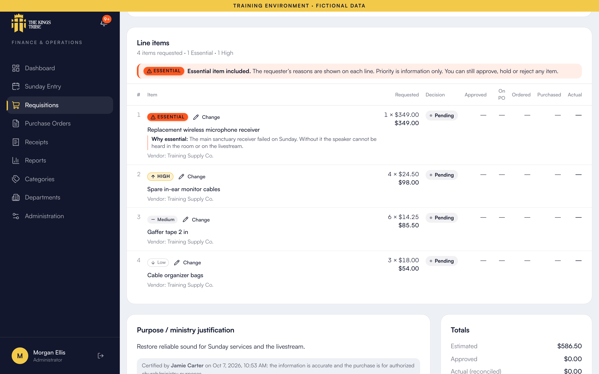
*Screenshot — S21 · Essential line with its reason*

### Change an item’s priority

**What this does:** Corrects the priority of one line.

**Who can do it:** Administrator, Head of Finance.

**Step-by-step**

1. On a line, tap **Change** next to its priority.
2. Choose the new priority.
3. If you choose Essential, explain **Why is this item essential?**
4. Tap **Save priority**.

**What happens next:** The new priority shows on the line.

**Important notes**

- The change is recorded in the audit history. It does not approve or reject the item.

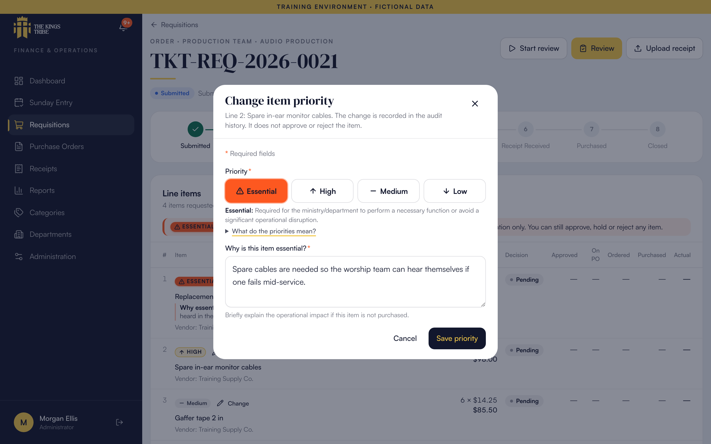
*Screenshot — S22 · Change item priority*

### Start review

**What this does:** Shows the team you are reviewing a request and moves it to **Under Review**.

**Who can do it:** Administrator, Head of Finance.

**Step-by-step**

1. Open a **Submitted** requisition.
2. Tap **Start review**.

**What happens next:** The status becomes Under Review and you are recorded as reviewer.

**Important notes**

- You can also go straight to **Review** without starting a review first.

*Screenshot — S23 · Start review on a Submitted request*

### Assign a reviewer and add comments

**What this does:** Records who owns the review and keeps internal notes.

**Who can do it:** Administrator, Head of Finance.

**Step-by-step**

1. In the **Review** panel, choose the **Assigned reviewer**.
2. Under **Internal comments**, type an **Internal comment**.
3. Tap **Add comment**.

**What happens next:** The assigned person is notified. Comments appear with name and time.

**Important notes**

- Internal comments are visible to staff only — never to the requester.

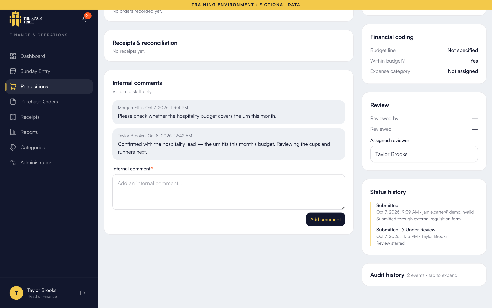
*Screenshot — S23 · Assigned reviewer and internal comments*

### Review: approve all

**What this does:** Approves every line, optionally adjusting quantities or prices.

**Who can do it:** Administrator, Head of Finance.

**Step-by-step**

1. Tap **Review**.
2. Choose **Approve**.
3. Adjust **Approved qty** or **Unit price** if needed; add coding (budget line, expense category).
4. Tap **Save decision**.

**What happens next:** The status becomes **Approved** and the request appears under Ready for PO (or the next step for its type). If requester notifications are configured, the requester may also receive an update.

**Important notes**

- Decisions: **Approve**, **Partially approve**, **Hold** (comment required) and **Reject** (comment required).

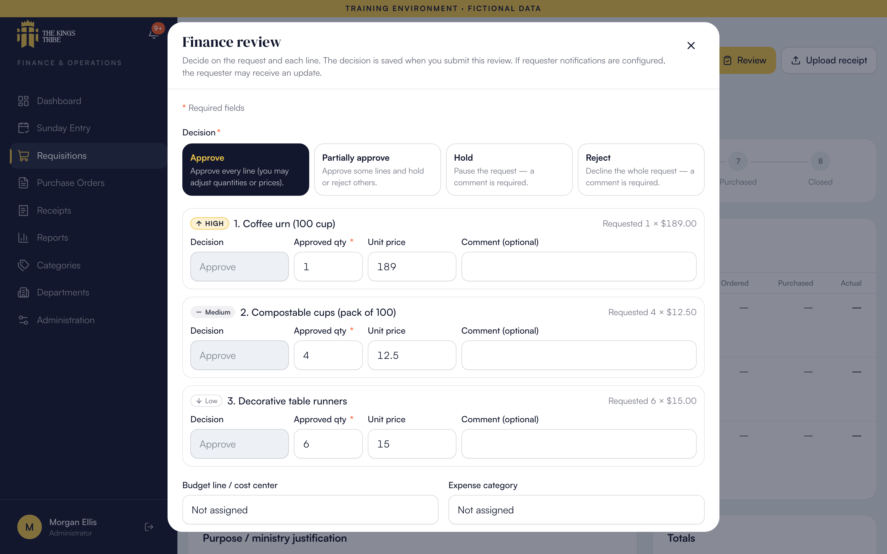
*Screenshot — S24 · Finance review — Approve*

### Review: mixed decisions

**What this does:** Approves some lines and holds or rejects others.

**Who can do it:** Administrator, Head of Finance.

**Step-by-step**

1. Tap **Review** and choose **Partially approve**.
2. For each line choose **Approve**, **Hold** or **Reject**.
3. Reduce **Approved qty** where only part is approved.
4. Give a **Reason** for each held or rejected line, then tap **Save decision**.

**What happens next:** The request becomes **Partially Approved**. The saved decision records which lines were approved and the reasons for held or rejected lines.

**Important notes**

- Lines approved at a lower quantity count as partial approval.
- If requester notifications are configured, the requester may receive the decision by email.

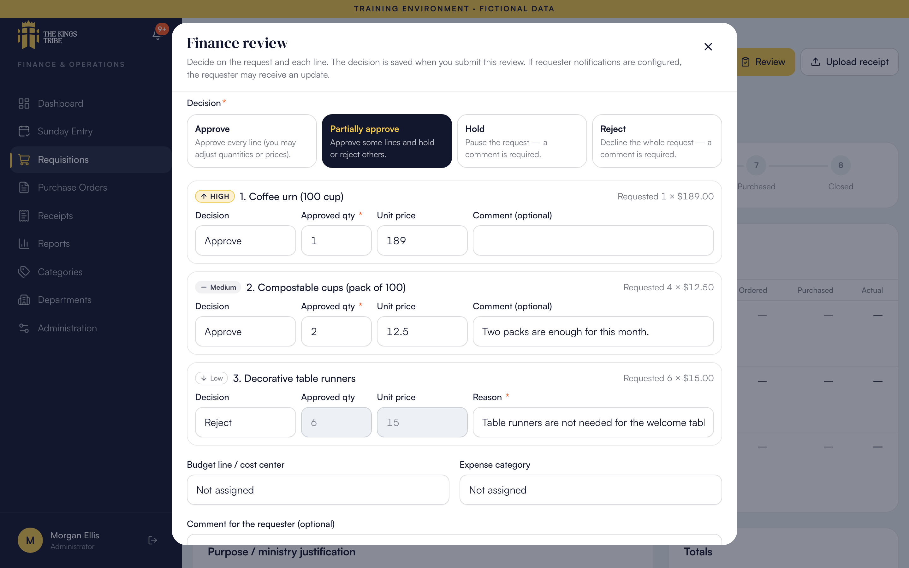
*Screenshot — S25 · Partial approval with per-line decisions*

### Partially Approved result

**What this does:** Shows the outcome of a partial approval.

**Who can do it:** Administrator, Head of Finance.

**Step-by-step**

1. Open the requisition after saving the review.
2. Check each line’s **Decision**, approved quantity and Finance note.

**What happens next:** Only approved quantities can go on a Purchase Order. Use **Issue PO** to continue.

**Important notes**

- Rejected lines show the reason given in review.

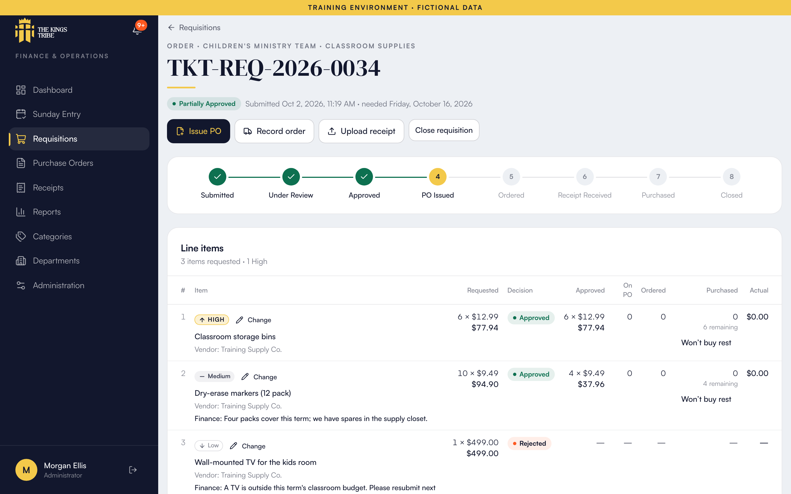
*Screenshot — S26 · Partially Approved requisition*

## 8. Purchase Orders & Ordering

### Issue a Purchase Order

**What this does:** Creates a Purchase Order (PO) for approved quantities and a branded PDF.

**Who can do it:** Administrator, Head of Finance.

**Step-by-step**

1. Open an approved requisition and tap **Issue PO**.
2. Tick the lines to include and check quantities and prices.
3. Add vendor details and notes if known.
4. Tap **Issue PO**.

**What happens next:** The status becomes **PO Issued** and the PO appears on the requisition. The confirmation tells you whether the PO was emailed to the requester; if it was not, download the PDF and share it.

**Important notes**

- Only approved quantities not already on a PO can be included.
- The PO is issued even when email is not set up; the confirmation message says whether it was emailed.
- Vendor details are optional when items come from several vendors.

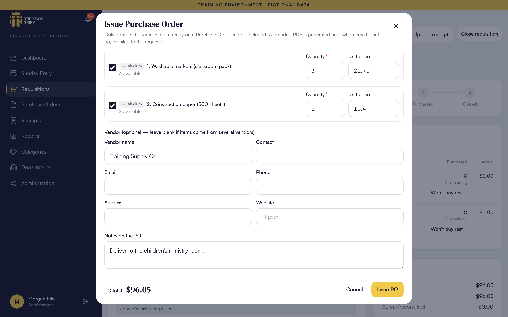
*Screenshot — S27 · Issue Purchase Order*

### The PO card

**What this does:** Shows each Purchase Order with its PDF and actions.

**Who can do it:** Administrator, Head of Finance.

**Step-by-step**

1. Open the requisition and scroll to **Purchase Orders**.
2. Download the PDF to share or print it.
3. Use **Void PO** (with a reason) if a PO must be withdrawn.

**What happens next:** A voided PO stays on record but no longer authorizes purchases.

**Important notes**

- All Purchase Orders are also listed on the **Purchase Orders** page.

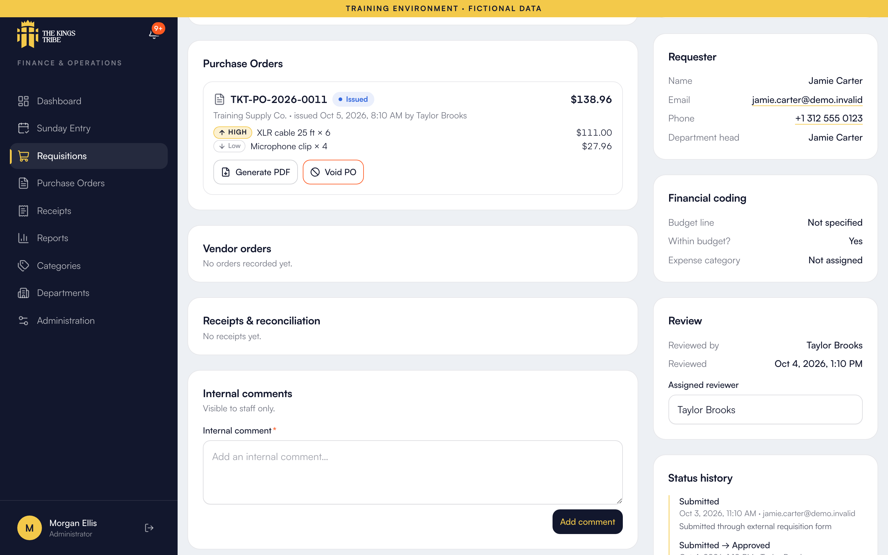
*Screenshot — S28 · Purchase Order card*

### Record a vendor order

**What this does:** Records what was actually ordered — all or part of each line.

**Who can do it:** Administrator, Head of Finance.

**Step-by-step**

1. Tap **Record order**.
2. Enter the **Vendor**, **Vendor order / reference #**, **Order date** and optional **Expected delivery**; choose the **Purchase Order**.
3. Enter **Qty ordered** and **Unit price** for each line.
4. Add notes and tap **Record order**.

**What happens next:** The status becomes **Ordered**. Remaining quantities can be ordered later, from one or more vendors.

**Important notes**

- Use **Cancel order** on an order if it was recorded in error; quantities return to “not yet ordered”.

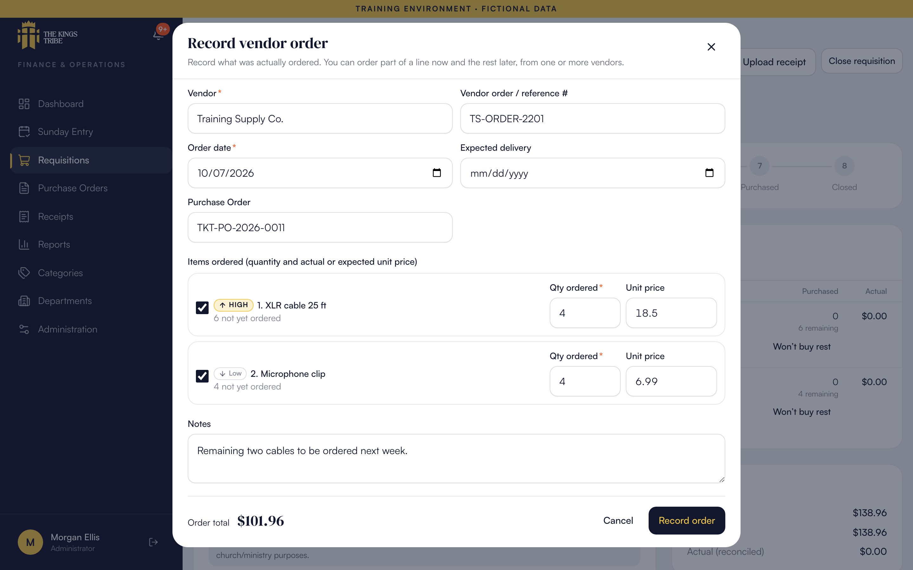
*Screenshot — S29 · Record vendor order (partial)*

## 9. Receipts, Reconciliation & Closing

### Upload a receipt

**What this does:** Attaches receipt files to a requisition.

**Who can do it:** Administrator, Head of Finance.

**Step-by-step**

1. Open the requisition and tap **Upload receipt**.
2. Tap **Take a photo or choose files**.
3. Check the **Purchase Order**, **Vendor**, **Purchase date**, **Receipt total** and **Receipt / invoice #**.
4. Tap **Upload receipt**.

**What happens next:** The receipt waits for reconciliation. Uploading does not mark anything purchased.

**Important notes**

- PDF, JPEG, PNG or HEIC · up to 10 MB each · up to 5 files.
- Receipts are stored privately.

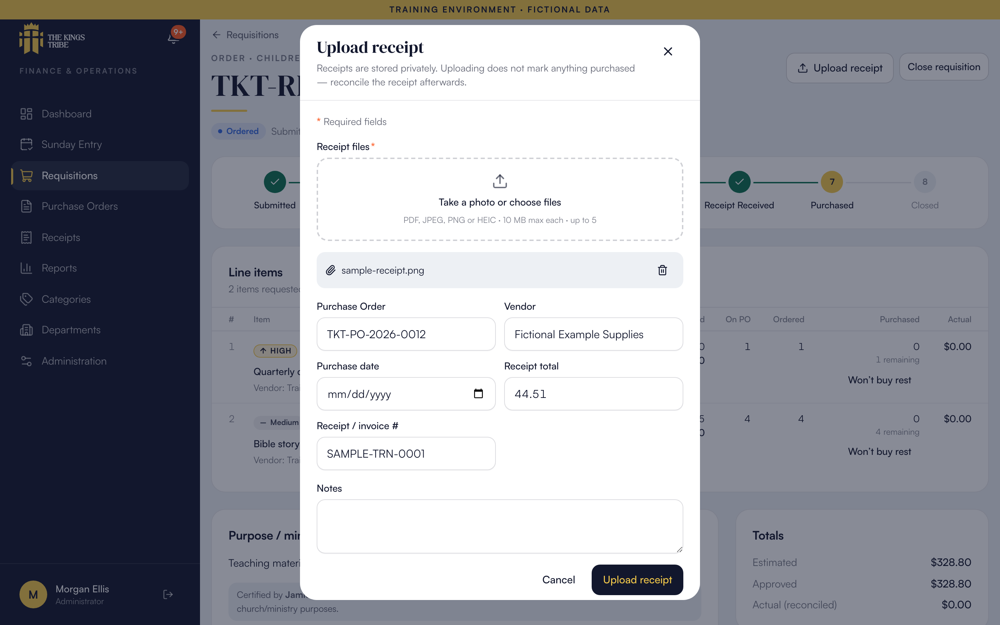
*Screenshot — S30 · Upload receipt (desktop)*

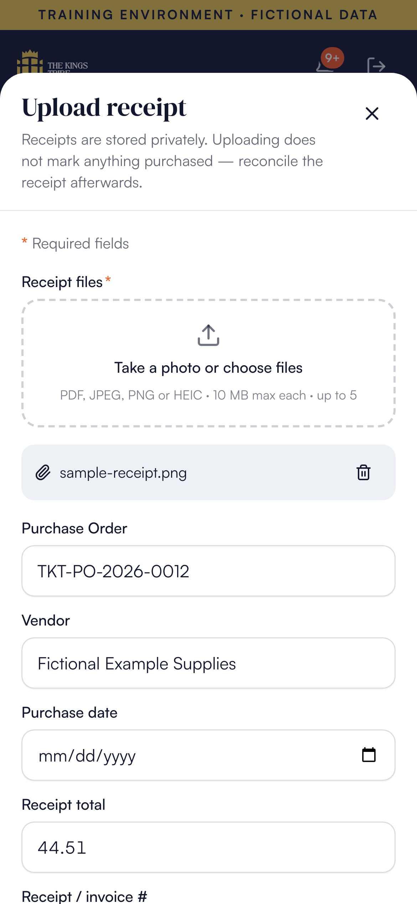
*Screenshot — S30 · Upload receipt (phone)*

### Reconcile a receipt

**What this does:** Records what a receipt actually covers, line by line.

**Who can do it:** Administrator, Head of Finance.

**Step-by-step**

1. On a pending receipt, tap **Reconcile**.
2. For each line on the receipt, enter **Qty bought** and **Actual cost**; leave other lines blank.
3. Check the variance and the allocated total.
4. Tap **Confirm reconciliation**.

**What happens next:** Purchased quantities and actual costs update. When everything approved is purchased, the status becomes **Purchased**; otherwise **Partially Purchased**.

**Important notes**

- Use **Reject receipt** for duplicates, unreadable images or receipts that don’t belong to the request.

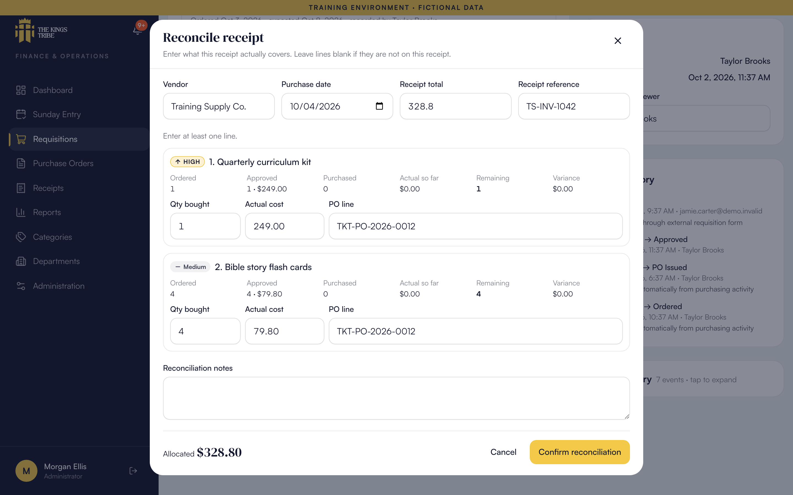
*Screenshot — S31 · Reconcile receipt*

### Won’t buy rest (partial purchase)

**What this does:** Marks approved quantity that will not be bought, so the request can complete.

**Who can do it:** Administrator, Head of Finance.

**Step-by-step**

1. On a Partially Purchased line, tap **Won’t buy rest**.
2. Enter the **Quantity not to purchase** (up to the remaining quantity).
3. Give a **Reason** and tap **Cancel remaining**.

**What happens next:** Remaining quantities update; when nothing is left to buy, the request can move to Purchased.

**Important notes**

- The reason is kept with the requisition.

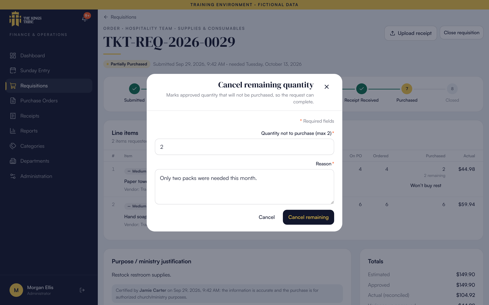
*Screenshot — S32 · Cancel remaining quantity*

### Receipts page

**What this does:** One queue of receipts waiting for reconciliation across all requisitions.

**Who can do it:** Administrator, Head of Finance.

**Step-by-step**

1. Open **Receipts**.
2. Open a waiting receipt and reconcile it from its requisition.

**What happens next:** Reconciled receipts leave the queue.

**Important notes**

- The page also has a section for receipts that arrive by email and cannot be matched automatically. Emailed receipts are a concept only in this training: they are not part of the verified training workflow.

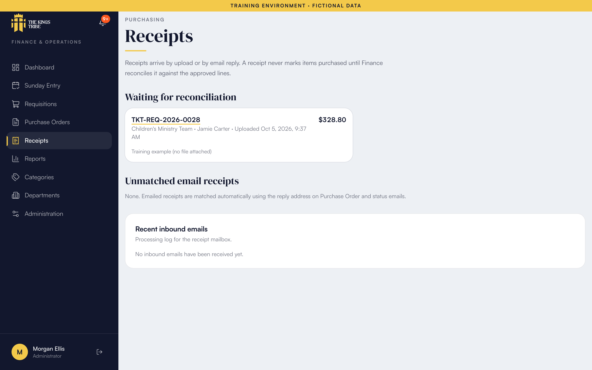
*Screenshot — S33 · Receipts page*

### Record a disbursement

**What this does:** Records money paid out — a check, cash or reimbursement.

**Who can do it:** Administrator, Head of Finance.

**Step-by-step**

1. Open the requisition and tap the payout button (for example **Record check issued** for an Advance Check).
2. Enter the **Amount**, **Method** (Cash, Check, Bank transfer or Other) and **Date paid**.
3. Add a **Check # / reference** and notes.
4. Tap **Save**.

**What happens next:** The disbursed total updates. The dialog shows how much remains within the approved amount.

**Important notes**

- Petty Cash and Advance Check are paid before purchase; Reimbursements are repaid after purchase.

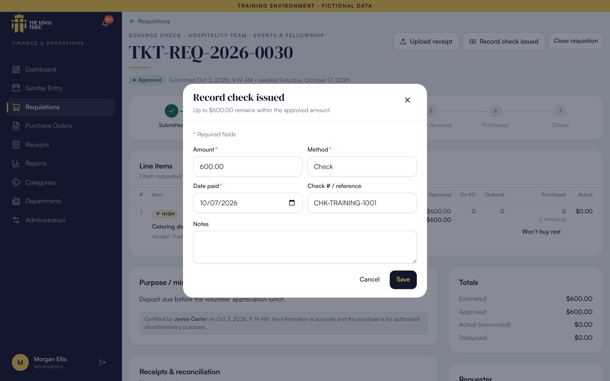
*Screenshot — S34 · Record check issued*

### Close a requisition

**What this does:** Marks a request as finished.

**Who can do it:** Administrator, Head of Finance.

**Step-by-step**

1. Open a **Purchased** requisition.
2. Tap **Close requisition**.
3. Add a comment if needed and tap **Close requisition** to confirm.

**What happens next:** The status becomes **Closed**; no further action is needed.

**Important notes**

- If purchasing is not complete, a comment explaining why is required.

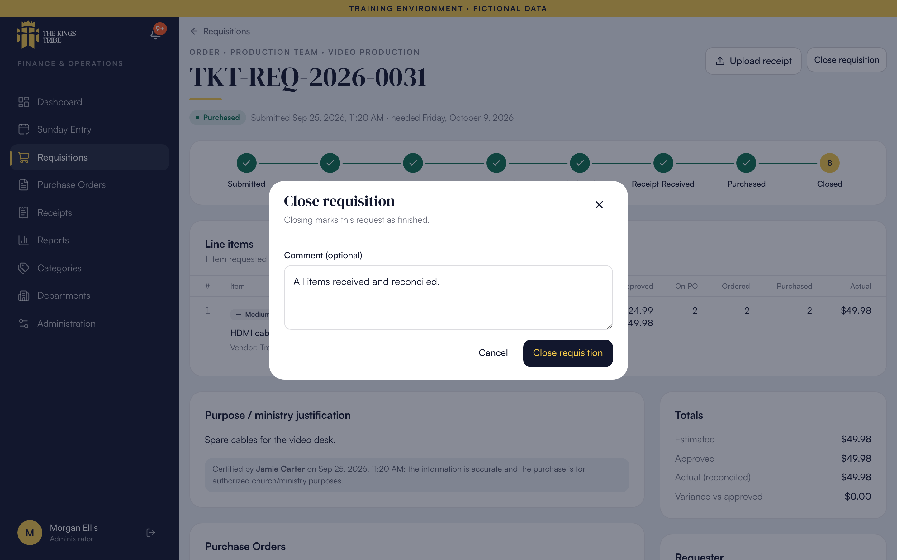
*Screenshot — S35 · Close requisition*

## 10. Reports

### Reports

**What this does:** Attendance, finance and requisition reporting for any period, with CSV export.

**Who can do it:** Administrator and Head of Finance (all tabs). Reporting User (Attendance).

**Step-by-step**

1. Open **Reports**.
2. Choose a tab: **Attendance**, **Finance** or **Requisitions & purchasing**.
3. Set **From** / **To** or use **Last 4 weeks**, **Year to date** or **Last 12 months**; choose weekly, monthly, quarterly or yearly grouping.
4. Tap **Apply**. Use **Export CSV** to download.

**What happens next:** Figures and charts update for the chosen period.

**Important notes**

- CSV dates follow the church’s timezone.

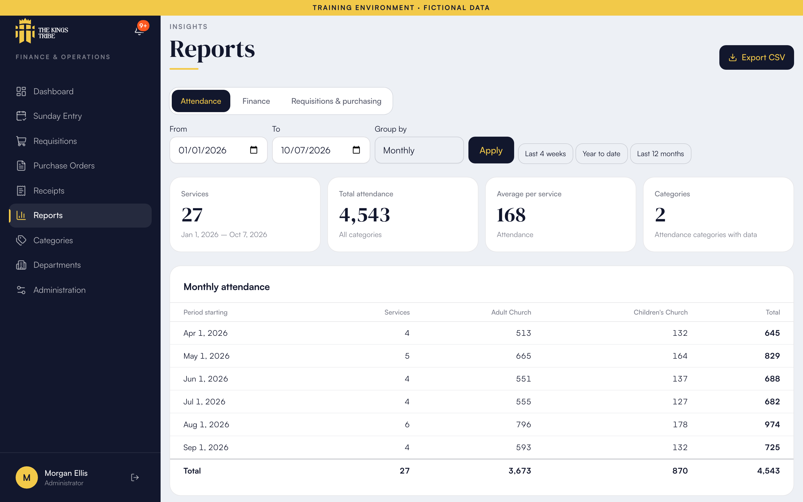
*Screenshot — S36 · Reports — Attendance*

## 11. Administration

### Setup wizard

**What this does:** Guides first-time setup: church information, notification email and policies, categories, departments, team and a requisition link.

**Who can do it:** Administrator.

**Step-by-step**

1. Open **Administration → Setup wizard**.
2. Complete each step; required steps are marked.
3. Tap **Mark setup complete** when all required steps are done.

**What happens next:** The setup reminder disappears. Every step can be revisited later from Administration.

**Important notes**

- Inviting your team is recommended, not required.

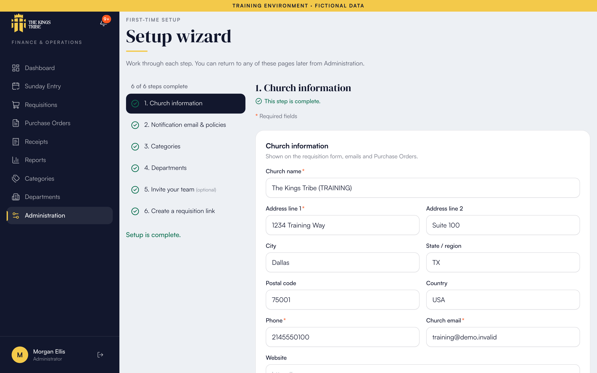
*Screenshot — S37 · Setup wizard*

### Church settings

**What this does:** Church name, address, contact details, currency, timezone, notification email and policy text shown on forms, emails and Purchase Orders.

**Who can do it:** Administrator.

**Step-by-step**

1. Open **Administration → Church settings**.
2. Update the details.
3. Tap **Save settings**.

**What happens next:** New forms, emails and POs use the updated details.

**Important notes**

- The timezone decides what “today” and “this Sunday” mean.

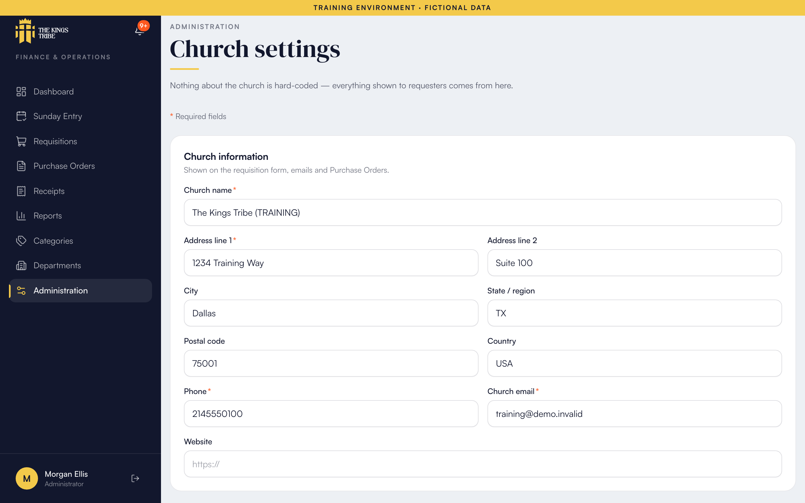
*Screenshot — S38 · Church settings*

### Users

**What this does:** Invites team members, assigns roles and deactivates accounts.

**Who can do it:** Administrator.

**Step-by-step**

1. Open **Administration → Users**.
2. Tap **Invite user**; enter **Full name**, **Email address** and roles.
3. Choose **Send an invitation email** or **Give me a link to send myself**, then tap **Invite**.
4. Tick or untick roles on any user; use **Deactivate** / **Reactivate** as needed.

**What happens next:** The new user shows **Invitation pending** until they set a password. Deactivated users show **Deactivated** and are signed out.

**Important notes**

- The last active Administrator cannot be removed or deactivated.
- A copy link can be used once; send it privately.

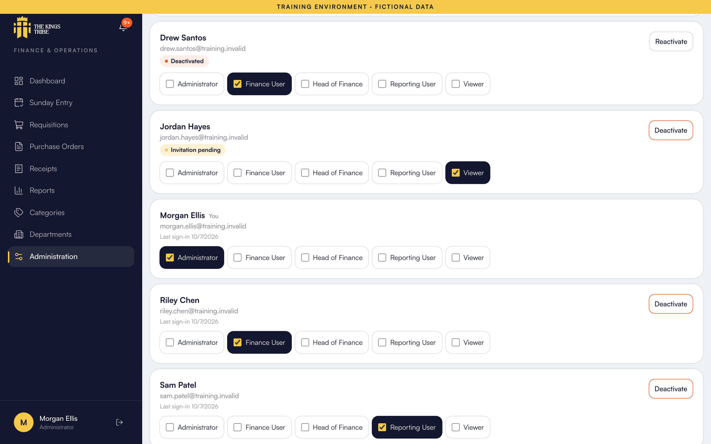
*Screenshot — S39 · Users — pending and deactivated examples*

### Roles & permissions

**What this does:** Shows what each role can do.

**Who can do it:** Administrator.

**Step-by-step**

1. Open **Administration → Roles & permissions**.
2. Review the permissions for each role.

**What happens next:** Use the grid to see which permissions each role includes.

**Important notes**

- Use the built-in role names in this guide when assigning roles.

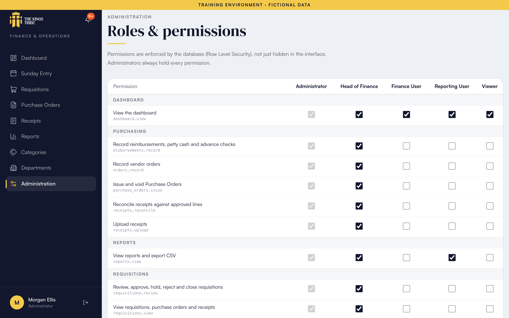
*Screenshot — S40 · Roles & permissions*

### Requisition links

**What this does:** Secure links department leads use to submit requests — nothing else.

**Who can do it:** Administrator, Head of Finance.

**Step-by-step**

1. Open **Administration → Requisition links**.
2. Tap **New requisition link**; set a **Label**, optional department limit, **Expires after (days)** and **Max submissions**.
3. Tap **Create link** and copy the link immediately.

**What happens next:** The link is listed with its status, expiry and submissions used.

**Important notes**

- Only a fingerprint of the link is stored — the full link cannot be shown again. If it is lost, use **Replace link**.
- Treat a link like a key. In these images the link is masked.

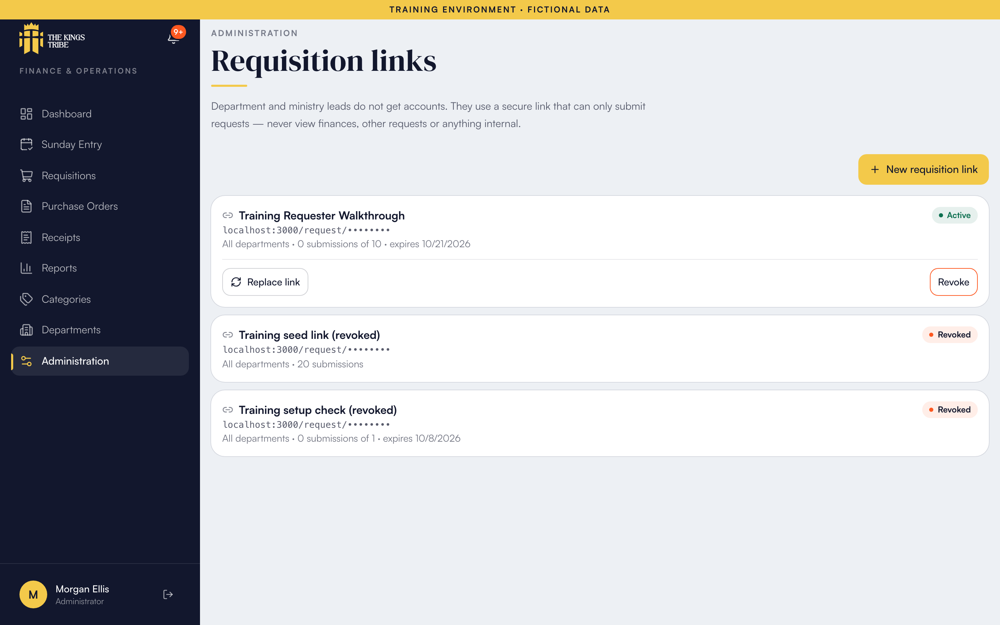
*Screenshot — S41 · Requisition links (link masked)*

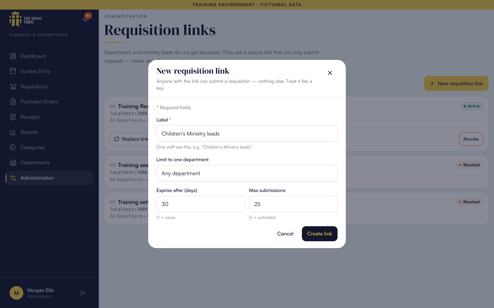
*Screenshot — S41 · New requisition link*

### Replace or revoke a link

**What this does:** Replaces a lost or shared link, or stops a link working.

**Who can do it:** Administrator, Head of Finance.

**Step-by-step**

1. On a link, tap **Replace link** to issue a new one, or **Revoke** to stop it.
2. Read the confirmation and confirm.

**What happens next:** Replacing revokes the old link and shows the new link once. Revoking stops submissions immediately.

**Important notes**

- Anyone using a revoked link sees “This link isn’t active” (Section 12).

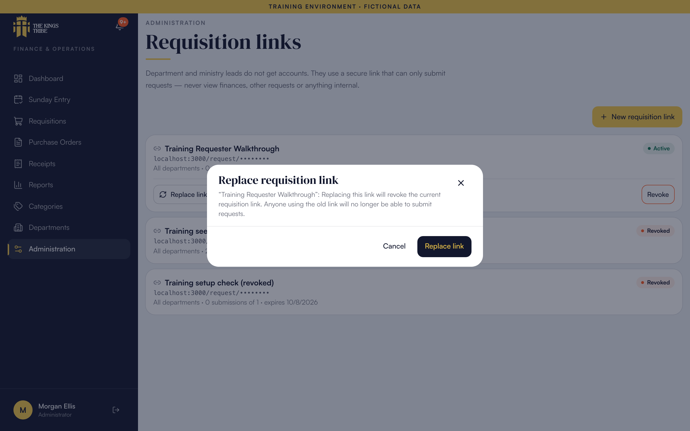
*Screenshot — S42 · Replace link*

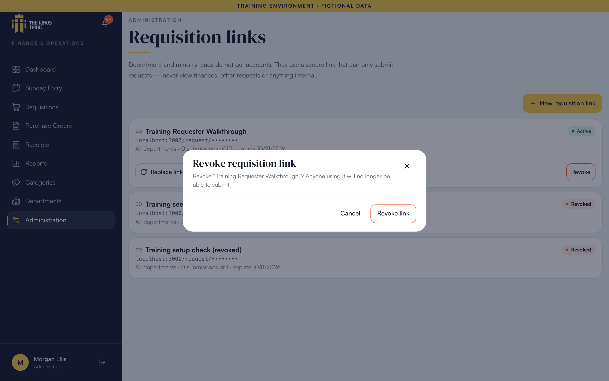
*Screenshot — S42 · Revoke link*

### Departments and Categories

**What this does:** Departments and subcategories appear on the request form; categories drive Sunday entry and expense coding.

**Who can do it:** Departments: Administrator. Categories: Administrator, Head of Finance.

**Step-by-step**

1. Open **Departments** or **Categories**.
2. Add, rename, reorder or archive items.

**What happens next:** Changes appear on forms and in Sunday entry.

**Important notes**

- Archive rather than delete items that have history.

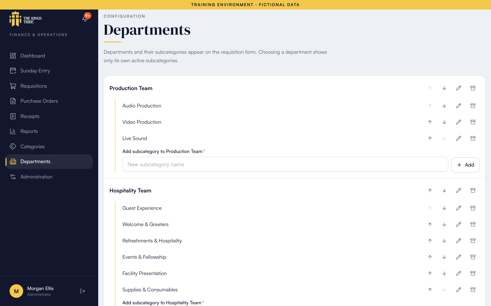
*Screenshot — S43 · Departments*

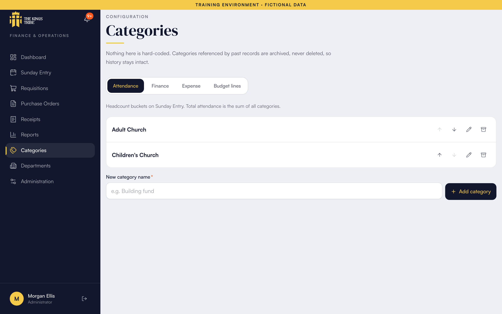
*Screenshot — S43 · Categories*

### Request types

**What this does:** Sets the rules for each request type (Order, Direct Purchase / Purchase Order, Reimbursement, Petty Cash, Advance Check).

**Who can do it:** Administrator.

**Step-by-step**

1. Open **Administration → Request types**.
2. Tap the edit icon on a type.
3. Adjust its rules and workflow, then save.

**What happens next:** The request form and requisition steps follow the new rules.

**Important notes**

- Rules decide, for example, whether a PO is issued and whether a receipt is required on submission.

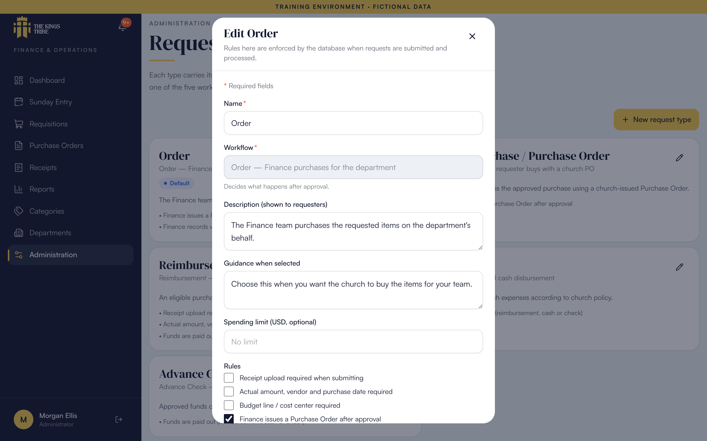
*Screenshot — S44 · Request type editor*

### Audit log

**What this does:** A permanent record of important changes: who, what and when, with before/after details.

**Who can do it:** Administrator, Head of Finance.

**Step-by-step**

1. Open **Administration → Audit log**.
2. Filter the entries.
3. Expand **Before / after** to see what changed.

**What happens next:** Entries cannot be edited or deleted.

**Important notes**

- Use the audit log to answer “who changed this, and when?”.

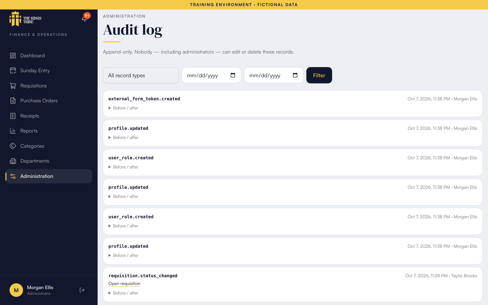
*Screenshot — S45 · Audit log*

## 12. External Requester Guide

For department and ministry leads. You don’t need an account — you use the secure requisition link your Finance team sends you.

### About you

**What this does:** Starts a request through your secure link.

**Who can do it:** Anyone with an active requisition link.

**Step-by-step**

1. Open the requisition link.
2. Read the requisition policy at the top.
3. Complete **About you**: your full name, email, phone and department head.

**What happens next:** Continue to Department & timing.

**Important notes**

- If requester email notifications are configured, updates may be sent to the email you enter.
- Do not share your link.

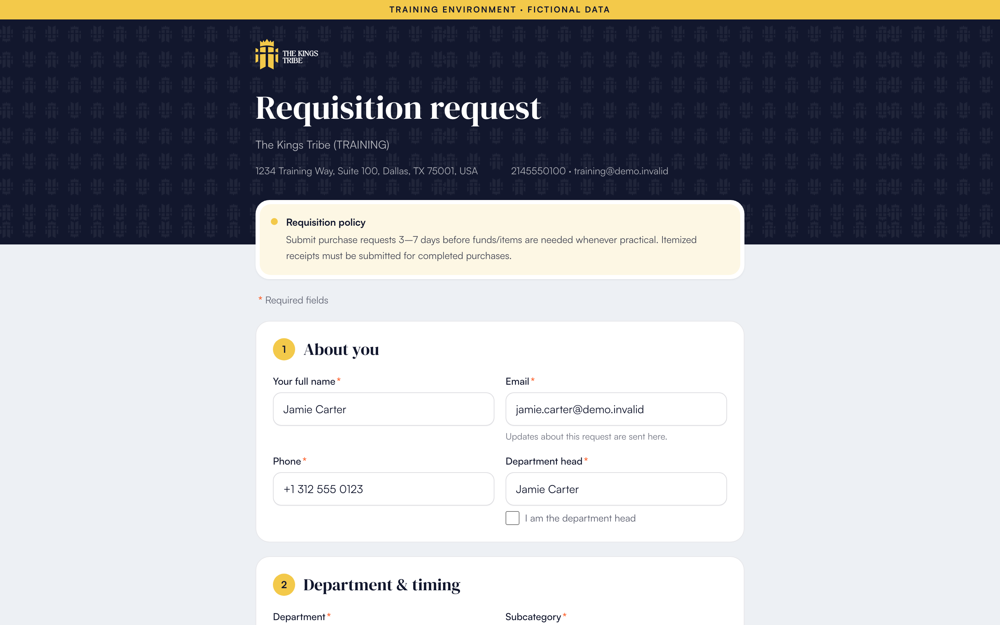
*Screenshot — S46 · About you (desktop)*

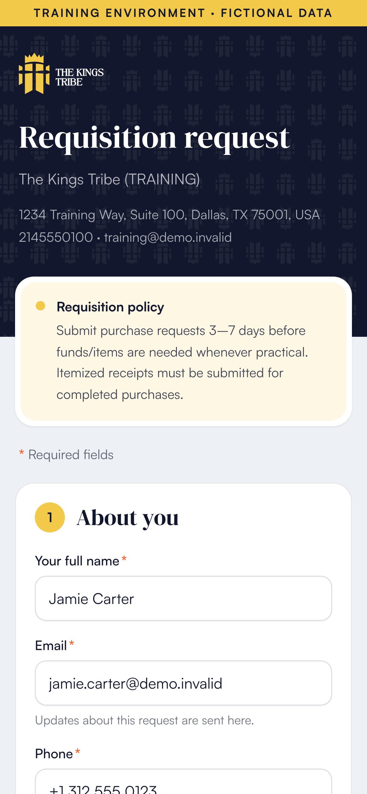
*Screenshot — S46 · About you (phone)*

### Department, timing and request type

**What this does:** Says who the request is for, when it’s needed and how it will be paid for.

**Who can do it:** Requesters.

**Step-by-step**

1. Choose your **Department** and **Subcategory**.
2. Set **Date items / funds are needed**.
3. Choose the **Request type** — read the description under each option.

**What happens next:** The rest of the form adapts to the request type.

**Important notes**

- **Date submitted** is recorded automatically when you submit.

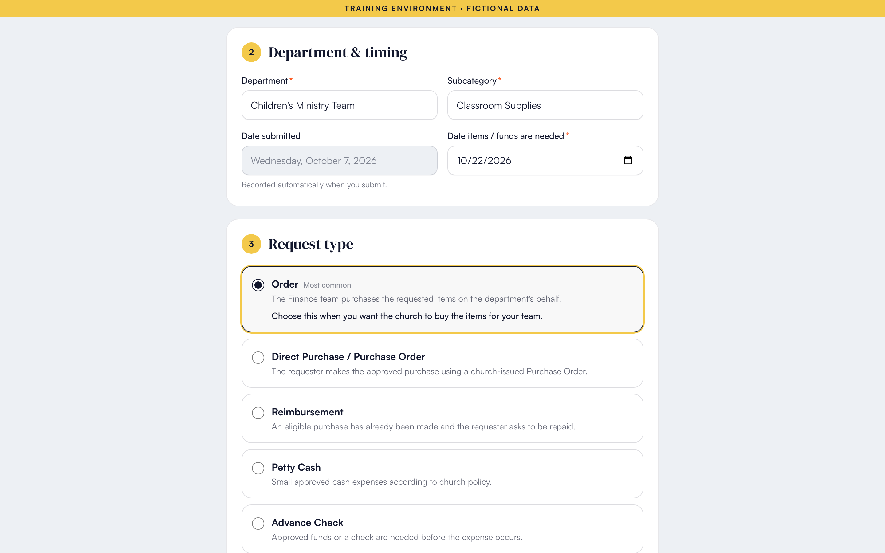
*Screenshot — S47 · Department, timing and request type*

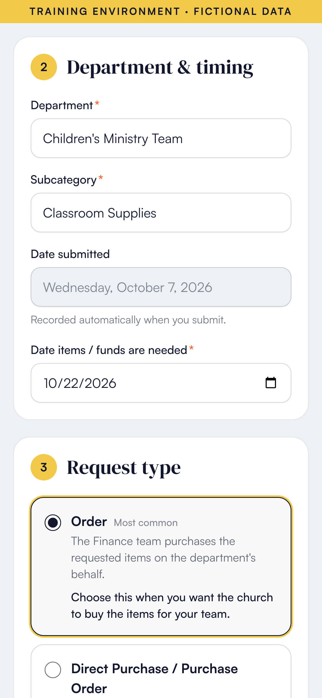
*Screenshot — S47 · On a phone*

### Items and product links

**What this does:** Lists what you need. A product link can fill in details for you.

**Who can do it:** Requesters.

**Step-by-step**

1. Under **Items requested**, optionally paste a **Product link** and tap **Get details**.
2. Check or enter the description, specifications, brand, model, quantity and estimated price.
3. Tap **Add Item** for more lines.

**What happens next:** The estimated requisition total updates as you go.

**Important notes**

- Product details are filled in only where they can be found; always check them.

*Screenshot — S48 · Product link*

*Screenshot — S48 · On a phone*

### Check fetched product details

**What this does:** Shows what **Get details** found and anything you must check.

**Who can do it:** Requesters.

**Step-by-step**

1. Read the message under the product link.
2. Check fields marked **FILLED**.
3. Enter anything missing — for example the price when a page lists more than one.

**What happens next:** Continue with priority and the rest of the form.

**Important notes**

- This image shows a **simulated training result** (no real retailer was contacted). Real results vary by website.

*Screenshot — S49 · Fetched details with a price warning (simulated training result)*

### Priority and “Why essential”

**What this does:** Tells Finance how urgent each item is.

**Who can do it:** Requesters.

**Step-by-step**

1. Choose a **Priority** for each item: Essential, High, Medium or Low.
2. If you choose **Essential**, explain **Why is this item essential?**

**What happens next:** Finance sees your priority and reason when reviewing.

**Important notes**

- Essential: required to perform a necessary function or avoid a significant operational disruption. Use “What do the priorities mean?” for all definitions.

*Screenshot — S50 · Priority and Essential reason*

*Screenshot — S50 · On a phone*

### Reimbursement and receipts

**What this does:** For purchases you already made: records what you paid and attaches the receipt.

**Who can do it:** Requesters choosing **Reimbursement**.

**Step-by-step**

1. Choose **Reimbursement** as the request type.
2. Enter **Actual amount paid**, **Vendor** and **Purchase date**.
3. Under **Itemized receipt**, tap **Take a photo or choose a file**.

**What happens next:** The receipt uploads when you submit.

**Important notes**

- An itemized receipt is required for reimbursement.
- PDF, JPEG, PNG or HEIC · up to 10 MB each · max 5.
- The receipt shown is a sample marked “SAMPLE — TRAINING — NOT A REAL RECEIPT”.

*Screenshot — S51 · Reimbursement with a receipt attached*

### Certification and submit

**What this does:** Confirms the request is accurate and sends it.

**Who can do it:** Requesters.

**Step-by-step**

1. Describe the purpose under **Purpose / ministry justification**.
2. Tick the certification and type **Your name**.
3. Tap **Submit requisition**.

**What happens next:** Your request goes to the Finance team for review.

**Important notes**

- Your certification is recorded with the date and time of submission. It is not a legally binding electronic signature.
- SMS functionality is not included in the currently verified training workflow.

*Screenshot — S52 · Certification & updates*

*Screenshot — S52 · On a phone*

### Request submitted

**What this does:** Confirms your request and gives you its number.

**Who can do it:** Requesters.

**Step-by-step**

1. Note your requisition number (for example TKT-REQ-2026-0043).
2. Check the summary: department, type, submitted date, date needed and items.

**What happens next:** Finance reviews the request. You can submit another with the same link if it is still active.

**Important notes**

- The page says a confirmation was emailed only when the email was actually sent. Otherwise it asks you to keep the number for reference.

*Screenshot — S53 · Request submitted*

### Emails you may receive

**What this does:** When requester email notifications are configured, requesters may receive updates as the request moves on.

**Who can do it:** Requesters.

**Step-by-step**

1. “We received your request” after submitting.
2. A status update when it is approved, partially approved, on hold or rejected.
3. “Purchase Order issued” with the PO when one is issued.
4. “Purchase completed” when everything is reconciled.

**What happens next:** Use the link at the bottom of an email to manage your email updates.

**Important notes**

- These images are rendered from the real email templates with fictional data and were never sent.

*Rendered email · not sent — S54 · Request received*

*Rendered email · not sent — S54 · Partially approved*

### Purchase Order and purchase emails

**What this does:** Later updates for the same request.

**Who can do it:** Requesters.

**Step-by-step**

1. Keep the PO email and give its details to the vendor if you are buying.
2. Keep itemized receipts for every purchase.

**What happens next:** Finance reconciles receipts and closes the request.

**Important notes**

- These images are rendered from the real email templates with fictional data and were never sent.

*Rendered email · not sent — S54 · Purchase Order issued*

*Rendered email · not sent — S54 · Purchase completed*

### Requester preferences

**What this does:** Lets you choose which updates you receive for a request.

**Who can do it:** Requesters (through the link in their emails).

**Step-by-step**

1. Open the manage-updates link at the bottom of an email.
2. Choose your preferences.

**What happens next:** Your choices apply to that request.

**Important notes**

- Your personal link is private — don’t forward it.

*Screenshot — S55 · Requester preferences*

### “This link isn’t active”

**What this does:** Shown when a requisition link has expired, reached its limit, been replaced or been revoked.

**Who can do it:** Requesters.

**Step-by-step**

1. Contact the Finance team who sent you the link.
2. Ask for a new link.

**What happens next:** Use the new link to submit your request.

**Important notes**

- Nothing you typed on an inactive link is submitted.

*Screenshot — S56 · Inactive link*

## 13. Notifications & Phone Alerts

Phone alerts are optional, short messages on your device. Images marked **Training illustration** are drawn guides — not screenshots — and iOS screens may look different on your phone. S12 is a **real capture** from the training environment, framed for this guide.

### 1 · Find the Phone notifications card

**What this does:** Starts phone alerts for this device.

**Who can do it:** Any staff member.

**Step-by-step**

1. Open **Notifications**.
2. Find **Phone notifications**.
3. Tap **Enable phone notifications**.

**What happens next:** Your device asks for permission.

**Important notes**

- On iPhone, install the app first (steps 5–7 below).

*Training illustration — S09 · Phone notifications off*

### 2 · Allow notifications

**What this does:** Gives TKT permission to show alerts.

**Who can do it:** Any staff member.

**Step-by-step**

1. When asked, tap **Allow**.

**What happens next:** The card switches on.

**Important notes**

- iOS asks only the first time. Appearance may vary by iOS version.
- If you tapped Don’t Allow, turn notifications on for the app in your device settings.

*Training illustration — S10 · iOS permission prompt (simplified)*

### 3 · Alerts are on

**What this does:** Confirms this device is registered and lets you choose which alerts to receive.

**Who can do it:** Any staff member.

**Step-by-step**

1. Check **On for this device.**
2. Choose **Important & actionable (recommended)** or **Important only**.
3. Remove a device from **Your devices** at any time.

**What happens next:** Alerts arrive for the events you chose.

**Important notes**

- Everything still appears in the bell and on the Notifications page.
- Signing out does not turn alerts off on a device — remove it here.

*Training illustration — S11 · Phone notifications on*

### 4 · Receive an alert

**What this does:** Important workflow alerts can appear on your Lock Screen.

**Who can do it:** Any staff member with alerts on.

**Step-by-step**

1. Read the short alert.
2. Tap it to open the exact requisition in the app.

**What happens next:** The app opens on that requisition’s detail page (after you sign in if needed).

**Important notes**

- Alerts never show amounts, items or names — details open in the app.

*Real capture · framed — S12 · Lock Screen alert*

### 5 · Install: tap Share

**What this does:** Installing is required for phone alerts on iPhone.

**Who can do it:** iPhone users.

**Step-by-step**

1. Open the platform in **Safari**.
2. Tap **Share**.

**What happens next:** The Share menu opens.

**Important notes**

- Toolbar layout may vary by iOS version and Safari settings.

*Training illustration — S13 · Safari Share button*

### 6 · Install: Add to Home Screen

**What this does:** Adds the app to your Home Screen.

**Who can do it:** iPhone users.

**Step-by-step**

1. Choose **Add to Home Screen**.
2. Tap **Add**.

**What happens next:** The app icon appears on your Home Screen.

**Important notes**

- Menu wording or position may vary by iOS version.

*Training illustration — S14 · Add to Home Screen (simplified)*

### 7 · Open from the Home Screen

**What this does:** Use the installed app for phone alerts.

**Who can do it:** iPhone users.

**Step-by-step**

1. Open the app from the Home Screen.
2. Sign in, then return to step 1.

**What happens next:** You can now enable phone notifications.

**Important notes**

- Requires iOS 16.4 or later.

*Training illustration — S15 · Home Screen icon*

## 14. Troubleshooting & FAQ

**I can’t sign in.**

Check your email address and password. Use **Forgot your password?** to request a password reset and follow the instructions provided by the sign-in service. Accounts are by invitation only — ask your administrator if you have not been invited, or if your account shows as deactivated.

**A menu or page is missing.**

Menus show only what your roles allow. See Section 15 and ask an administrator if you need more access.

**“Phone notifications aren’t available yet.”**

Phone alerts have not been set up for this site yet. You still see everything in the bell and on the Notifications page.

**On iPhone, the card says to add the app to the Home Screen first.**

Install the app (Section 4), open it from the Home Screen, sign in, then enable notifications.

**“Notifications are blocked for this site.”**

Allow notifications for the app in your device or browser settings. In-app notifications keep working.

**I tapped an alert — what opens?**

The exact page the alert refers to, such as the requisition. If you are signed out, sign in and you are taken there.

**A requester didn’t get a confirmation email.**

The confirmation page says an email was sent only when it was actually sent. Ask the requester for the requisition number shown on screen.

**The PO message says it wasn’t emailed.**

The PO was still issued. Download the PDF from the PO card and share it with the requester.

**A requisition link says “This link isn’t active.”**

It has expired, reached its submission limit, been replaced or been revoked. Send the requester a new link (Section 11).

**The request form won’t submit.**

Check highlighted fields. Essential items need a reason; Reimbursements need the amount paid, vendor, purchase date and an itemized receipt; the certification must be ticked.

### You’re offline

**What this does:** Shown when the device has no connection.

**Who can do it:** Everyone.

**Step-by-step**

1. Reconnect to the internet.
2. Return to the app and continue.

**What happens next:** The app loads normally once you are back online.

**Important notes**

- Financial information is never stored on the device.

*Screenshot — S57 · Offline page*

## 15. Role Quick Reference

| Area | Administrator | Head of Finance | Finance User | Reporting User | Viewer |
| --- | --- | --- | --- | --- | --- |
| Dashboard | ✓ | ✓ | ✓ | ✓ | ✓ (attendance) |
| Notifications & phone alerts | ✓ | ✓ | ✓ | ✓ | ✓ |
| Sunday entry — attendance | ✓ |   |   | ✓ |   |
| Sunday entry — finance | ✓ | ✓ | ✓ |   |   |
| Requisitions & review | ✓ | ✓ |   |   |   |
| Purchase Orders & vendor orders | ✓ | ✓ |   |   |   |
| Receipts, reconciliation & disbursements | ✓ | ✓ |   |   |   |
| Reports | ✓ | ✓ |   | ✓ (Attendance) |   |
| Categories | ✓ | ✓ |   |   |   |
| Departments | ✓ |   |   |   |   |
| Requisition links | ✓ | ✓ |   |   |   |
| Audit log | ✓ | ✓ |   |   |   |
| Setup, settings, users, roles, request types | ✓ |   |   |   |   |

**External requesters** have no account and use a requisition link only (Section 12).

> **NOTE:** If you need access you don’t have, ask an Administrator to review your roles.

## 16. Support

For help with your account, access or a request:

**[SUPPORT CONTACT TO BE CONFIRMED]**

- Have the requisition number (for example TKT-REQ-2026-0043) ready if your question is about a request.
- Never share passwords, requisition links or private links from emails.
- Department leads should contact the Finance team who sent their link.

## 17. Revision History

| Version | Date | Changes |
| --- | --- | --- |
| Draft 0.1 | October 2026 | First full draft from the training environment (screens S01–S57). |

All screens use the training environment with fictional data. Screens S09–S11 and S13–S15 are training illustrations; S12 is a real capture, framed; S49 shows a simulated product lookup; S54 shows emails rendered from the real templates and never sent.
